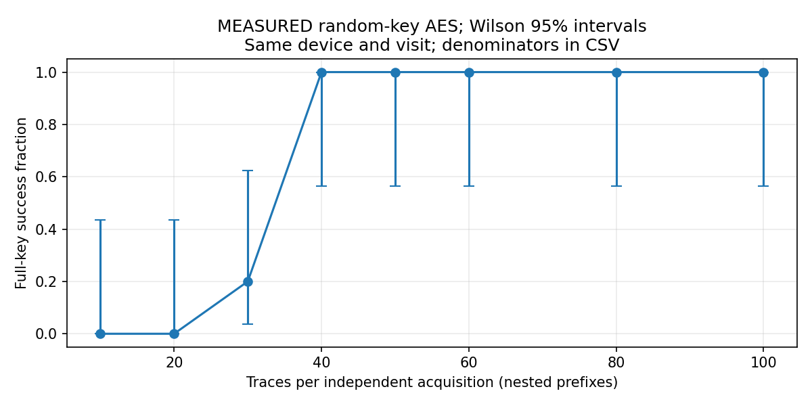

# ChipWhisperer-Nano AES-128 CPA Lab

A hands-on study of **power side-channel analysis** using the ChipWhisperer-Nano and its integrated STM32F030 target. The project reproduces an AES-128 correlation power analysis (CPA) exercise, then extends it with **five fresh random-key capture runs**, trace-count comparisons, and exploratory offline leakage analyses.

The objective is to gain practical experience with real power-trace acquisition, leakage modelling, key recovery, and reproducible evaluation. This is an educational experiment on an intentionally unprotected AES implementation, **not a novel attack or an evaluation of a production device**.

## Highlights

- **Real hardware:** ChipWhisperer-Nano with its built-in STM32F030 target; 5,000 samples per captured trace.
- **Initial fixed-key experiments:** recovered all 16 bytes of both an all-zero AES-128 test key and a nonzero test key, using 100 traces per dataset.
- **Additional random-key experiments:** five separate capture runs, each using a freshly generated random AES-128 key and recording 100 physical power traces. All **500 ciphertexts** passed independent AES checks.
- **Key recovery:** all 16 key bytes recovered in **5/5 capture runs using exactly 40 traces per run**, and again using 100 traces per run, on the recorded datasets.
- **Published evidence:** code, measured trace archives, trial manifests, per-run results, plots, and tests.

## Experimental approach

The target runs NewAE's SimpleSerial AES firmware using `TINYAES128C`. For each candidate key byte, CPA correlates measured power samples with the predicted Hamming weight of the first-round AES S-box output:

$$
L(p,k) = \mathrm{HW}(\mathrm{SBOX}(p \oplus k)).
$$

Here, $p$ is a known plaintext byte and $k$ is a candidate AES key byte. The operator $\oplus$ denotes bitwise XOR; $\mathrm{SBOX}$ is the AES substitution box; and $\mathrm{HW}$ (Hamming weight) counts the number of set bits in a byte. For each of the 256 possible values of $k$, the model predicts an intermediate value's data-dependent leakage across plaintexts. CPA computes Pearson correlation between these predictions and the measured power samples, then ranks the candidate keys by their maximum absolute correlation.

The [original notebook](aes128_cpa_nano.ipynb) documents the fixed-key setup, firmware build and programming, known-answer checks, trace collection, and CPA analysis. The later [random-key capture script](scripts/capture_random_keys.py) records new traces using the already installed firmware and verifies each ciphertext with an independent AES implementation. The [offline analysis script](scripts/analyze_aes.py) calculates key-byte rankings and recovery results from the saved traces.

## Measured results

The table below shows **full 16-byte key recovery**, aggregated over five separate capture runs on the *same* Nano during *one* experimental session. Each run uses a fresh random key; the trace counts are nested prefixes of that run's 100 measured traces.

| Traces per run | Fully recovered AES-128 keys |
| ---: | ---: |
| 10 | 0 / 5 |
| 20 | 0 / 5 |
| 30 | 1 / 5 |
| **40** | **5 / 5** |
| 50 | 5 / 5 |
| 60 | 5 / 5 |
| 80 | 5 / 5 |
| 100 | 5 / 5 |



See the [aggregate CSV](results/random-key-20261101/independent-trials.csv), [machine-readable results](results/random-key-20261101/independent-trials.json), and [per-run plots](results/random-key-20261101/). For the original fixed-key measurements, see the [setup and reproduction guide](docs/experiment_setup.md) and the [notebook](aes128_cpa_nano.ipynb).

## Reproduce the offline analysis

With Python installed, run the following commands from the repository root:

```bash
python -m pip install -r requirements-analysis.txt
python scripts/analyze_aes.py data/random-key-20261101/trial-00.npz data/random-key-20261101/trial-01.npz data/random-key-20261101/trial-02.npz data/random-key-20261101/trial-03.npz data/random-key-20261101/trial-04.npz --manifest-dir data/random-key-20261101 --out results/local-reanalysis
```

The output directory must not already exist. The script checks saved plaintext/ciphertext correspondence and produces fresh JSON, CSV, and figures. All five [trace archives and capture-run manifests](data/random-key-20261101/) are committed to the repository. Repeating physical capture requires a ChipWhisperer-Nano and a correctly configured firmware/host environment; see [docs/experiment_setup.md](docs/experiment_setup.md).

## Additional analyses and limitations

The repository also compares alternative leakage hypotheses and negative controls. Timing shifts are **artificially introduced into measured traces offline**; alignment experiments are exploratory software analysis, **not a deployed hardware countermeasure**.

All five random-key capture runs used one device in one session, without a power cycle. Thus 5/5 successes at 40 traces **do not establish a general 40-trace threshold or a dependable attack success rate**. The Wilson 95% interval for 5/5 is approximately 56.6%–100% *if the runs are treated as independent*. The exact installed firmware image hash was not verified. The original notebook's inclusive `trace_range` indexing is documented in the [fixed-key results erratum](docs/experiment_setup.md#4-original-fixed-key-results); the newer analysis uses exact prefix counts.

## References and acknowledgment

This learning project builds on [NewAE ChipWhisperer](https://github.com/newaetech/chipwhisperer), its [documentation and tutorials](https://chipwhisperer.readthedocs.io/), and [NIST FIPS 197 (AES)](https://csrc.nist.gov/pubs/fips/197/final).
